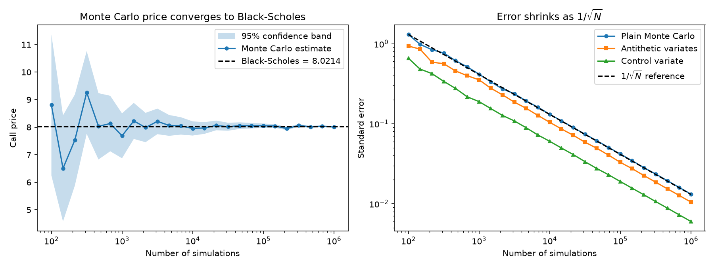
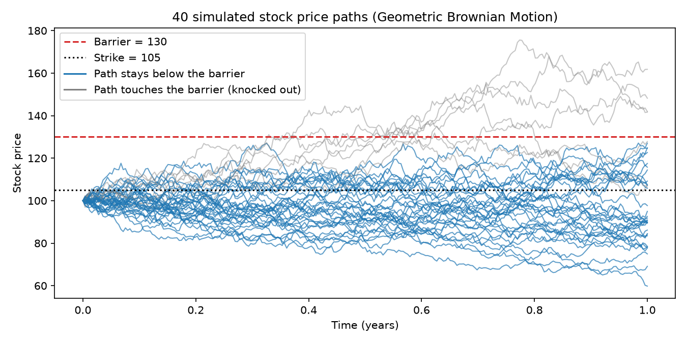

# Monte Carlo Option Pricer

A from-scratch option pricer in Python and NumPy. It prices European options
with the exact Black-Scholes formula and by Monte Carlo simulation, shows that
the two agree, makes the simulation more efficient with variance reduction,
computes Greeks, and then prices path-dependent options (Asian and barrier)
that have no simple formula.



## Results at a glance

All numbers are for the example option used throughout: stock price 100,
strike 105, 1 year to expiry, 5% interest rate, 20% volatility.

**European call, 100,000 simulations (exact Black-Scholes price: 8.0214)**

| Method | Price | Standard error | Variance reduction |
|---|---|---|---|
| Plain Monte Carlo | 8.0062 | 0.0419 | 1.0x |
| Antithetic variates | 8.0369 | 0.0333 | 1.6x |
| Control variate | 8.0463 | 0.0191 | 4.8x |

**Greeks, 100,000 simulations**

| Greek | Monte Carlo | Exact |
|---|---|---|
| Call delta | 0.5381 ± 0.0019 | 0.5422 |
| Put delta | -0.4612 ± 0.0013 | -0.4578 |
| Call vega | 39.67 ± 0.24 | 39.67 |

**Exotic options, 50,000 paths of 252 daily steps**

| Option | Price | Standard error |
|---|---|---|
| Asian call (arithmetic average), plain | 3.5193 | 0.0287 |
| Asian call (arithmetic average), control variate | 3.5255 | 0.0009 |
| Up-and-out barrier call (barrier 130) | 2.1342 | 0.0210 |
| Up-and-in barrier call (barrier 130) | 5.8847 | 0.0598 |

The control variate for the Asian call cuts the variance by about 900x: the
same accuracy as plain Monte Carlo with roughly 900 times fewer paths.

## How to run it

```
pip install -r requirements.txt

python black_scholes.py    # exact prices and Greeks
python monte_carlo.py      # Monte Carlo vs Black-Scholes, three methods
python greeks.py           # delta and vega by simulation
python exotics.py          # Asian and barrier options
python convergence.py      # writes convergence.png
python plot_paths.py       # writes paths.png
python -m pytest           # 19 tests
```

## What we built, step by step

1. **Black-Scholes formulas** for a call and a put, checked with put-call parity.
2. **Simulating final stock prices** with Geometric Brownian Motion, vectorized
   with NumPy so 100,000 prices take milliseconds.
3. **Monte Carlo pricing** with a standard error and a 95% confidence interval
   on every price.
4. **A convergence chart** showing the price settling on the Black-Scholes
   value and the error shrinking as 1/√N.
5. **Variance reduction**: antithetic variates and a control variate.
6. **Greeks** (delta and vega) by finite differences with common random numbers.
7. **Exotic options**: full path simulation, Asian calls and barrier calls.
8. **Packaging**: a refactor, tests, this README, and git.

## The ideas behind the code

### 1. What an option is worth

A European **call** pays `max(S_T - K, 0)` at expiry: the amount the final
stock price `S_T` ends above the strike `K`, or nothing. A **put** pays
`max(K - S_T, 0)`. The price today is the *average* payoff over all possible
futures, discounted back to today's money by multiplying by `exp(-r*T)`.

### 2. Black-Scholes: the exact answer

For European options that average can be worked out with a formula:

```
call = S * N(d1) - K * exp(-r*T) * N(d2)
put  = K * exp(-r*T) * N(-d2) - S * N(-d1)
```

`N(x)` is the bell-curve probability of being below `x`. This formula is the
project's answer key: any simulation must reproduce it before we trust it on
options that have no formula.

**Put-call parity** (`call - put = S - K * exp(-r*T)`) is a relationship that
must hold whatever the model, so it is a good check for mistakes.

### 3. Simulating the stock price

The model for the final stock price is Geometric Brownian Motion:

```
S_T = S * exp( (r - sigma²/2) * T  +  sigma * sqrt(T) * Z )
```

- `Z` is a random draw from the standard bell curve: the "luck" of one future.
- `(r - sigma²/2) * T` is the steady drift every future shares.
- `sigma * sqrt(T) * Z` is the random shock, scaled by volatility.
- The randomness sits inside `exp`, so prices can never go negative.
- The `- sigma²/2` term makes the *average* simulated price come out at exactly
  `S * exp(r*T)`.

### 4. Monte Carlo pricing

1. Simulate many final prices.
2. Work out the payoff in each future and discount it.
3. Average them. That average is the price.
4. Report the **standard error**, `std / sqrt(N)`: how much the answer would
   move if you re-ran it with different random numbers. The 95% confidence
   interval is `price ± 1.96 * standard error`.

The `sqrt(N)` is the catch. Halving the error needs 4x the simulations, and
10x the accuracy needs 100x. That is the reason for the next section.

### 5. Variance reduction

**Antithetic variates.** Use every random shock twice: once as `Z` and once as
`-Z`. A lucky future is always paired with its unlucky mirror image, so their
errors partly cancel. The two halves of a pair are linked, so the standard
error is measured on the pair averages, not the individual payoffs.

**Control variate.** The discounted final stock price has a known average: it
is exactly today's price `S`. If the simulated stock prices came out a little
too high, the call payoffs came out too high as well, so we correct each one:

```
adjusted payoff = payoff - beta * (discounted S_T - S)
```

The correction averages to zero, so the price is unchanged, but much of the
noise is removed. `beta = cov(payoff, S_T) / var(S_T)` removes the most.

On the chart above, both methods keep the same slope as plain Monte Carlo but
sit lower: the same error for fewer simulations.

### 6. Greeks

Greeks measure how the price reacts when an input changes.

- **Delta**: price change per 1.00 move in the stock.
- **Vega**: price change per 1.00 move in volatility.

The code prices the option with the input nudged up and again nudged down, and
divides the difference by the nudge. The important detail is **common random
numbers**: both prices use the same random shocks. Without that, the difference
of two noisy prices is mostly noise. With it, the delta's standard error falls
from about 0.03 to 0.002.

### 7. Exotic options

A European option depends only on where the stock ends. Exotic options depend
on the whole journey, so the code simulates full paths, one step per trading
day.



**Asian call.** Pays `max(average price along the path - K, 0)`. Averaging
smooths out the price, so it is much cheaper than the European call (3.53
against 8.02). There is no exact formula for the arithmetic average, so this
is a case where simulation is needed.

There *is* an exact formula for the **geometric** average. The code uses it in
two ways: as an answer key for the path simulator (Monte Carlo 3.3365 ± 0.0274,
exact 3.3423), and as a control variate for the arithmetic Asian call. The two
averages move almost identically, which is why the variance drops about 900x.

**Barrier call.** An up-and-out call is cancelled if the stock ever reaches
the barrier; an up-and-in call only switches on if it does. On every path
exactly one of the two pays out, so their prices must add up to the European
call. They do: 2.1342 + 5.8847 = 8.0190, against the exact 8.0214.

## The code, file by file

### `black_scholes.py` — exact formulas

| Function | What it does |
|---|---|
| `OptionParams`, `EXAMPLE` | The five inputs (S, K, T, r, sigma) bundled together. It can be unpacked with `*`, so `black_scholes_call(*EXAMPLE)` works. |
| `call_payoff`, `put_payoff` | Payoff at expiry. Work on one price or a whole array. |
| `discount_factor` | `exp(-r*T)`, turns future money into today's money. |
| `norm_cdf`, `norm_pdf` | Bell-curve probability and height, built from `math.erf` (no scipy needed). |
| `d1_d2` | The two intermediate numbers in the Black-Scholes formula. |
| `black_scholes_call`, `black_scholes_put` | The exact prices. |
| `bs_call_delta`, `bs_put_delta`, `bs_vega` | The exact Greeks. |

### `monte_carlo.py` — European options by simulation

| Function | What it does |
|---|---|
| `terminal_prices` | The GBM formula: turns random shocks `Z` into final prices. Kept separate from drawing `Z` so antithetic sampling and the Greeks can reuse the same shocks. |
| `simulate_many_prices` | Draws `n_sims` shocks and returns that many final prices. |
| `summarize` | Turns independent samples into (price, standard error, 95% interval). Every pricer in the project ends with this. |
| `control_variate_adjust` | The control-variate correction, shared with the Asian option. |
| `monte_carlo_price` | The core pricer. Takes the payoff as a *function*, plus `method="plain"`, `"antithetic"` or `"control"`. |
| `monte_carlo_call`, `monte_carlo_put` | Thin wrappers that pass in the right payoff. |

Randomness comes from a NumPy generator passed in as `rng`
(`np.random.default_rng(seed)`). The same seed always gives the same price,
which makes results repeatable and the tests deterministic.

### `greeks.py` — sensitivities

| Function | What it does |
|---|---|
| `_finite_difference` | Prices with an input bumped up and down on the same shocks and returns the difference per unit of bump, with a standard error. |
| `mc_delta` | Bumps the stock price (by 1% of S). |
| `mc_vega` | Bumps the volatility (by 0.01). |

### `exotics.py` — path-dependent options

| Function | What it does |
|---|---|
| `simulate_paths` | Returns an array of shape (paths, steps + 1). Each step multiplies the price by `exp(small drift + small shock)`; a cumulative sum of the exponents builds every path at once. |
| `geometric_asian_call_exact` | Exact price of the geometric-average Asian call. |
| `asian_call` | Arithmetic or geometric Asian call, with an optional control variate. |
| `barrier_call` | Up-and-out or up-and-in call, barrier checked at each step. |

### `convergence.py` and `plot_paths.py` — the charts

`convergence.py` prices the call at 25 simulation counts from 100 to 1,000,000
and draws the price with its confidence band and the standard error of each
method. `plot_paths.py` draws 40 sample paths with the strike and barrier.

### `tests/test_pricer.py` — 19 tests

- Black-Scholes: known values, put-call parity, the zero-volatility limit.
- Monte Carlo: each method lands within 4 standard errors of Black-Scholes;
  control variate beats antithetic beats plain; same seed gives the same price.
- Greeks: delta and vega match the exact values; common random numbers reduce
  the noise.
- Exotics: geometric Asian matches its formula; geometric < arithmetic <
  European; knock-out plus knock-in equals the European call; a barrier that
  can never be reached gives the European price.

## Limitations

- The model assumes constant volatility and interest rate (Black-Scholes
  world). Real markets show volatility smiles.
- The barrier is checked once per step (daily), so a path that crosses and
  comes back between two steps is missed. The up-and-out price is therefore
  slightly higher than it would be with continuous monitoring.
- The control-variate `beta` is estimated from the same samples it corrects,
  which adds a small bias that vanishes as the number of simulations grows.
- Only European-style exercise is covered; American options need a different
  method (for example Longstaff-Schwartz).
